<div align="center">

<sub><a href="README.md">中文</a> · <b>English</b> · <a href="https://joeymilano.github.io/joey-design/">Live Gallery</a> · <a href="https://joeymilano.github.io/joey-design/field-test/">20-Second Blind Test</a></sub>

<br><br>

<a href="https://joeymilano.github.io/joey-design/">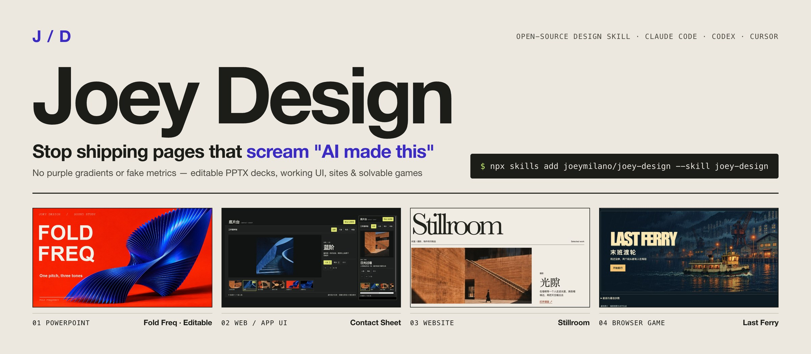</a>

<br>

[](LICENSE)
[](https://skills.sh)
[](#installation)
[](#installation)
[](#installation)
[](https://github.com/joeymilano/joey-design/actions/workflows/design-review.yml)
[](https://github.com/joeymilano/joey-design/stargazers)

**A product designer's handoff habits, packaged for your coding agent**<br>
Drop it into Claude Code, Codex, or Cursor — get back real editable `.pptx` decks, interfaces people can actually operate, editorial sites, and solvable browser games.

```sh
npx skills add joeymilano/joey-design --skill joey-design
```

[20-Sec Blind Test](#dont-take-my-word-for-it--take-the-20-second-blind-test) · [Four Real Deliverables](#four-things-you-can-hand-off-right-away) · [How It Kills AI Slop](#the-studio-rules-behind-it) · [Art Direction](#three-cover-proofs-first-then-the-whole-system) · [30-Sec Install](#installation) · [FAQ](#questions-you-might-have)

</div>

---

You can spot an unguided AI page from across the room:

Purple-to-indigo gradients, glass cards nested inside cards, a little rounded icon badge above every heading, "Unlock a seamless next-gen experience," and three testimonials from customers who don't exist. Worse: ask it for a presentation deck and it hands you an HTML page nobody on your team can edit five minutes before the meeting.

I'm a product designer. Every time I caught myself rebuilding an agent's output from scratch, the issue wasn't code — nobody had taught the agent **what finished work actually looks like when you hand it to a real human**.

So I turned my own layout, copywriting, and QA habits into **Joey Design**.

---

## Don't take my word for it — take the 20-second blind test

Saying "no AI slop" is easy. Testing it head-to-head is better.

We gave three isolated sessions the exact same brief, model, and constraints: **build an offline Saturday sign-up page for a neighborhood repair shop** so visitors can compare morning vs. afternoon slots, claim a spot, and undo a mistake. We ran it across **150k-star `UI UX Pro Max`**, **Anthropic's `Frontend Design`**, and **`Joey Design`**:

[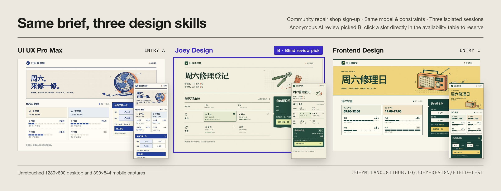](https://joeymilano.github.io/joey-design/field-test/)

**[Open the live blind test and click through all three ↗](https://joeymilano.github.io/joey-design/field-test/)**

Tool names are hidden by default. Pretend you're booking a Saturday slot for a broken fan, try reserving and undoing, then reveal who built what at the bottom. An anonymous AI review picked **Entry B (Joey Design)** because clicking a cell in the availability table selects the slot directly — while we also credit Entry A's crisp top summary and link Entry C's raw first-round QA log.

We ran a deck shootout too: **two photo books, four weeks of sales and inventory, two weeks to print — build a four-slide Monday meeting deck so the back row can decide which book to reprint first.**

[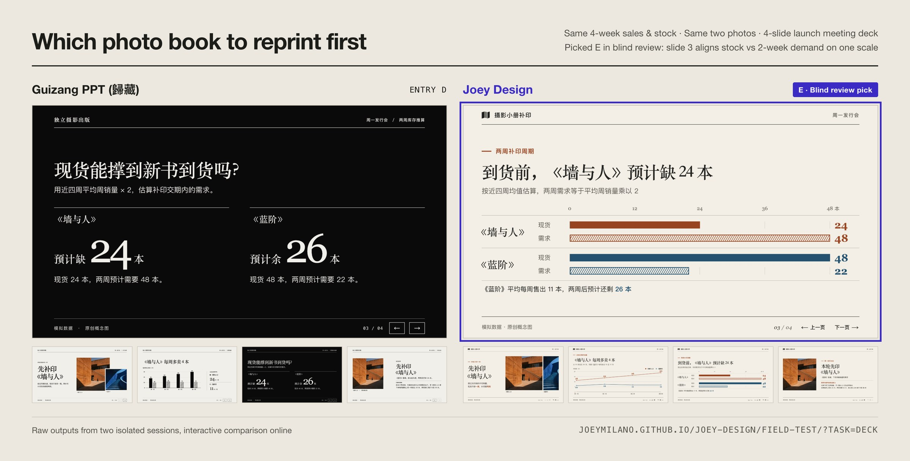](https://joeymilano.github.io/joey-design/field-test/?task=deck)

**[Flip through both four-slide decks side by side ↗](https://joeymilano.github.io/joey-design/field-test/?task=deck)**

Put yourself in the back row on slide 3: Entry D's dark slide looks bold from afar, but makes you do arithmetic in your head; **Entry E (Joey Design)** plots current stock and two-week demand on one shared scale so the shortage jumps right out. Every brief, SHA-256 hash, and raw HTML file is public on the page.

---

## Four things you can hand off right away

Every sample below opens offline. Click around first, then steal any prompt underneath and swap in your own material:

| | |
| :-- | :-- |
| [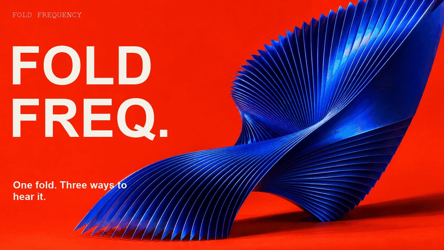](https://joeymilano.github.io/joey-design/fold-deck-en.html) | [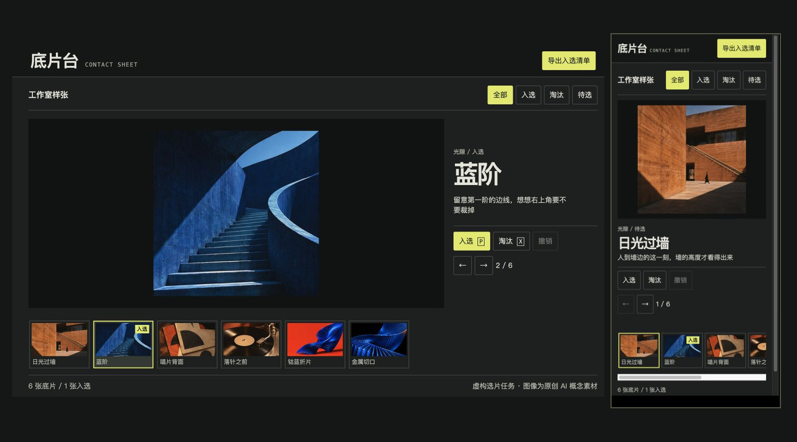](https://joeymilano.github.io/joey-design/contact-sheet.html) |
| **01 · Real Editable PowerPoint · Fold Frequency**<br>Not a web page cosplaying as slides — a native `.pptx` your teammates can open in PowerPoint or Keynote to edit text, swap photos, and read speaker notes.<br>**[Flip through web preview ↗](https://joeymilano.github.io/joey-design/fold-deck-en.html)** · **[Download editable PPTX ↗](https://joeymilano.github.io/joey-design/fold-deck-en.pptx)**<br><sub>Ask your agent: "Turn this product brief into an 8-slide launch deck, keep the original photos, add a pricing comparison table, and give me an editable PPTX"</sub> | **02 · Working Web / App UI · Contact Sheet**<br>Built like a photographer's light table: big frame for the photo you're judging, `P` to pick, `X` to reject, instant undo when your finger slips, and JSON export.<br>**[Open and press P / X to try it ↗](https://joeymilano.github.io/joey-design/contact-sheet.html)**<br><sub>Ask your agent: "Build a mobile-friendly asset review desk — large previews, approve or reject by keyboard, undo mistakes"</sub> |
| [](https://joeymilano.github.io/joey-design/stillroom.html) | [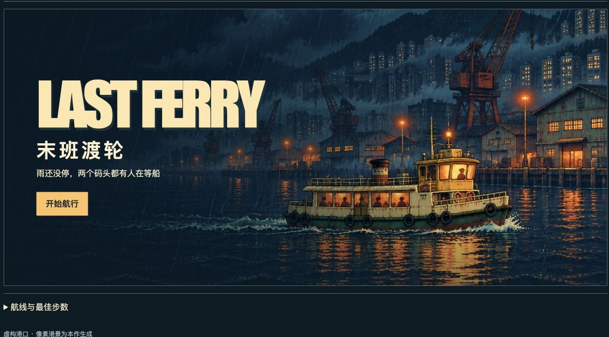](https://joeymilano.github.io/joey-design/last-ferry.html) |
| **03 · Zero-Fluff Editorial Site · Stillroom**<br>No "Welcome to our studio" filler hero. Opens straight on the work, pairs a wide shot with a close-up per project, and gives every piece a clean client link.<br>**[Walk through the portfolio ↗](https://joeymilano.github.io/joey-design/stillroom.html)**<br><sub>Ask your agent: "Build a photography site from these three series — photos first, with a direct shareable link for every project"</sub> | **04 · Solvable Browser Game · Last Ferry**<br>Rainy harbor, passengers waiting on two piers. Play with arrow keys or touch; pier lights go dark as you dock. A solver checks every map fits its move budget before shipping.<br>**[Play three routes ↗](https://joeymilano.github.io/joey-design/last-ferry.html)**<br><sub>Ask your agent: "Make a short game playable with arrow keys and touch — title screen, three levels, results, and retry"</sub> |

**One small detail presentation folks love:** open [Side-B Listening Room](https://joeymilano.github.io/joey-design/listening-room.html) and download its [3-slide PPTX](https://joeymilano.github.io/joey-design/listening-room.pptx). Right-click the chart on slide 2 in PowerPoint and hit **Edit Data** — there's a real Excel workbook inside, generated from the exact same [JSON source](skills/joey-design/assets/studies/listening-room.json) as the web page.

---

## The studio rules behind it

Everything that usually takes three rounds of human art direction is written into rules and deterministic scripts:

- **Start with the reader's decision, not a template.** Are they deciding which book to reprint or picking a Saturday repair slot on their phone? Once the decision is clear, the layout practically draws itself.
- **Borrow shapes from the subject itself.** A photo picker looks like a film contact strip; a ferry game shows remaining moves as fuel. No default purple SaaS glow.
- **Cut every line that could belong to another company.** If "Empowering seamless workflows" fits a dentistry app and a crypto wallet equally well, delete it. Buttons say `verb + object` ("Export selected picks", "Download sample sheet").
- **Never invent what didn't happen.** Zero made-up growth percentages, fake customer quotes, or imaginary awards. Estimates say they're estimates right on the slide.
- **Click through desktop and phone before calling it done.** Test long names, full capacity, errors, and undo first — then run `review` at `1280×800` and `390×844` so you never ship a brittle screenshot.

| What unguided agents default to | What Joey Design enforces |
| --- | --- |
| Purple gradients, glass cards, three equal icon columns | Dominant shape, scale, and palette pulled from your actual material; one job per screen |
| "Unlock a seamless next-gen experience" | Plain copy tied to this specific object; state what clicking actually gives the user |
| Made-up "+300% conversion" badges and fake quotes | Only facts from your brief; estimates and demo data explicitly labeled |
| Pretty hero screenshot that breaks on click or mobile | Keyboard shortcuts, touch targets, empty states, and undo verified at two widths |
| HTML slides pretending to be PowerPoint | Native `.pptx` with editable text, cropped photos, speaker notes, and chart workbooks |

Dive deeper in [SKILL.md](skills/joey-design/SKILL.md) · [product-work.md](skills/joey-design/references/product-work.md) · [art-direction.md](skills/joey-design/references/art-direction.md) · [design-review.md](skills/joey-design/references/design-review.md).

---

## Three cover proofs first, then the whole system

On visual-heavy projects, good designers don't marry their first sketch. `directions` takes the exact same headline and photo and renders three distinct cover compositions so you can compare scale, crop, and reading order side by side — then carries the winning motif across slides, 3:4 social carousels, and mobile screens.

<p align="center">
  <a href="https://joeymilano.github.io/joey-design/fold-deck-en.html">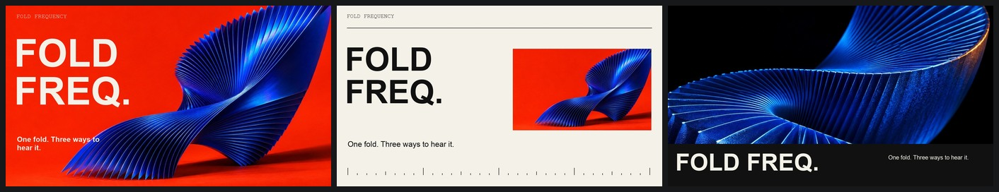</a>
</p>

<p align="center">
  <a href="https://joeymilano.github.io/joey-design/fold-deck-en.html">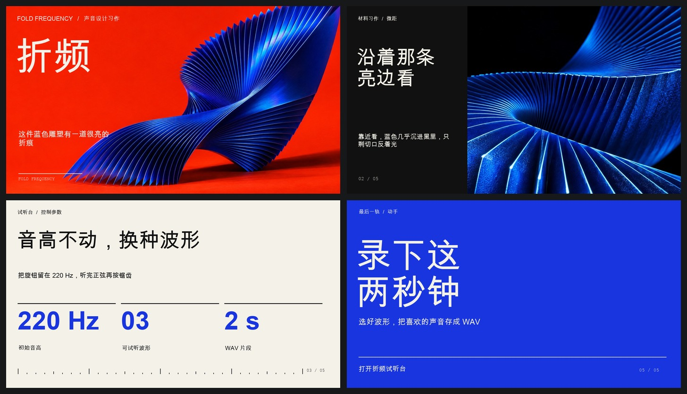</a>
</p>

<p align="center">
  <a href="https://joeymilano.github.io/joey-design/archive.html#social">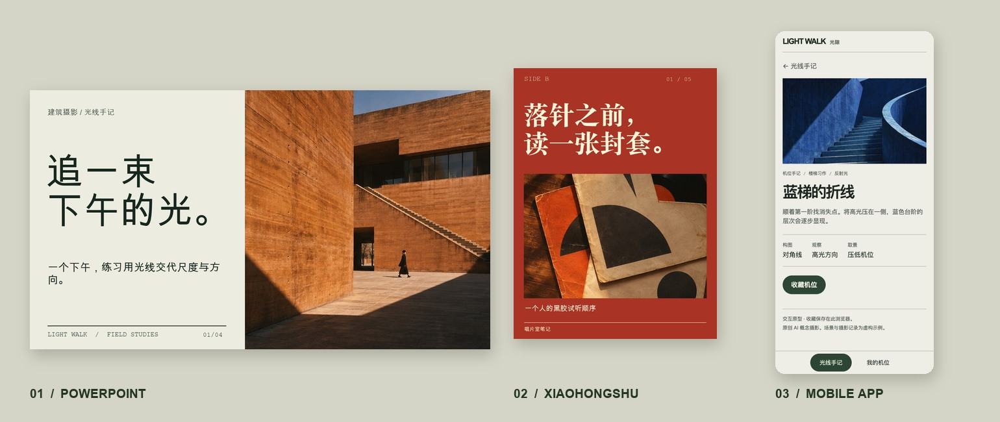</a>
</p>

<p align="center">
  <a href="https://joeymilano.github.io/joey-design/archive.html">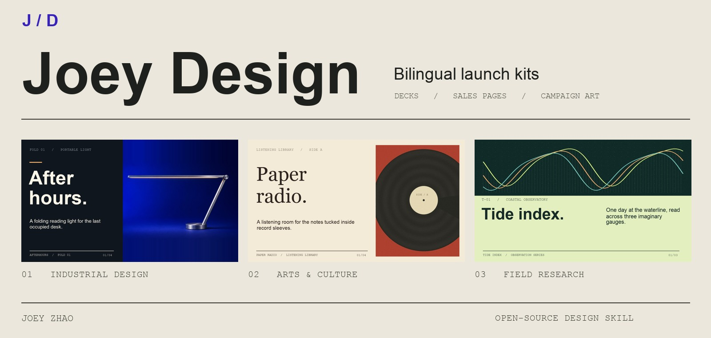</a>
</p>

<p align="center">
  <a href="https://joeymilano.github.io/joey-design/archive.html">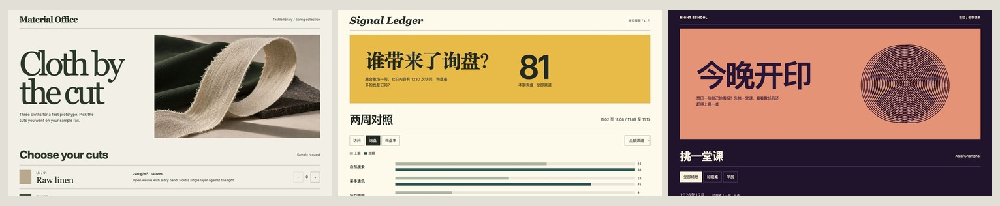</a>
</p>

[Browse the full demo archive ↗](https://joeymilano.github.io/joey-design/archive.html) · [Download the three cover proofs (.zip)](https://joeymilano.github.io/joey-design/fold-proofs.zip)

---

<a id="installation"></a>

## Install in 30 seconds and try it on real work

```sh
npx skills add joeymilano/joey-design --skill joey-design
```

Pick **Claude Code**, **Codex**, **Cursor**, or your preferred client in the prompt — or simply copy [`skills/joey-design`](skills/joey-design) into your agent's skills directory.

No special slash-command syntax to memorize. Just talk to your agent the way you'd brief a designer on Slack:

```text
Turn this product note into an 8-slide launch deck, keep the original photos, include a pricing comparison table, and export an editable PPTX
```

```text
Clean up our current review dashboard — make the image preview much larger, add keyboard approve/reject shortcuts, and let reviewers undo mistakes
```

### How it runs under the hood

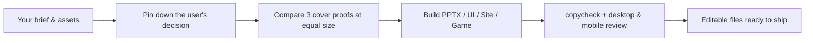

<details>
<summary><b>Want to run the Python compiler directly? View CLI commands (Python 3.9+)</b></summary>

<br>

| Command | What it hands back |
| --- | --- |
| `build` | Bilingual editable `.pptx`, HTML web deck, and campaign page |
| `ui` | Offline Web / App interface with keyboard, touch, persistence, and undo |
| `site` | Responsive portfolio, brand, or landing site with shareable deep links |
| `game` | Browser game prototype with automated BFS solvability verification |
| `directions` | Three equal-size cover studies from the same copy and artwork |
| `social` | 3:4 social media carousel cards and image pack |
| `app` | Focused mobile app study |
| `scenario` | Operational pages for sourcing, channel reporting, or scheduling |
| `check` / `copycheck` | Brief validation and bilingual copy / punctuation checks |
| `review` | Automated desktop + mobile user-journey walkthrough with screenshots |

Build all four reference studies locally from the repo root:

```sh
python3 -m venv .venv
. .venv/bin/activate
python -m pip install -r skills/joey-design/requirements.txt

SKILL=skills/joey-design
python "$SKILL/scripts/joey.py" build "$SKILL/assets/studies/fold-deck.json" --out build/ppt
python "$SKILL/scripts/joey.py" ui "$SKILL/assets/studies/contact-sheet.json" --out build/ui
python "$SKILL/scripts/joey.py" site "$SKILL/assets/studies/stillroom.json" --out build/site
python "$SKILL/scripts/joey.py" game "$SKILL/assets/studies/last-ferry.json" --out build/game
```

On Windows use `.venv\Scripts\activate`. On Linux install `fonts-noto-cjk` when rendering CJK text.

</details>

---

## Questions you might have

<details>
<summary><b>I already use UI UX Pro Max, Impeccable, or Frontend Design — should I still install this?</b></summary>

<br>

Yes — they complement each other nicely:
- **UI UX Pro Max** is great as a searchable catalog of palettes, styles, and font pairings.
- **Impeccable** shines at critiquing and nudging existing front-end components.
- **Joey Design** owns the end-to-end studio handoff: starting from the user's decision, spanning **native editable `.pptx` decks, working UIs, editorial sites, and solvable browser games**, enforcing strict anti-slop copy rules (especially for bilingual English/Chinese teams), and walking the finished output in a real browser at two widths.

</details>

<details>
<summary><b>Will it wreck my existing React / Next.js / Vue app?</b></summary>

<br>

No. Inside an existing codebase, Joey Design keeps your stack, routing, real copy, and state intact — applying its task-first hierarchy and desktop/mobile review loop to your components rather than replacing your app with a static template.

</details>

<details>
<summary><b>Do the web outputs need internet access? Can I use this commercially?</b></summary>

<br>

Every standalone web build opens offline with zero external CDN calls. The repository is [MIT licensed](LICENSE) for personal and commercial work — just swap the demo concept illustrations for your own licensed photography or product shots before shipping to customers.

</details>

---

## Leave a Star if it saves you a revision round

If you're tired of stripping purple gradients out of CSS or rebuilding uneditable AI slide decks at midnight, I hope this saves you an evening.

Dropping a **Star** up top helps more builders and designers find it — and if you run into a stubborn AI design habit we haven't killed yet, open an [Issue](https://github.com/joeymilano/joey-design/issues) and we'll add a rule for it.

<a href="https://star-history.com/#joeymilano/joey-design&Date">
  <picture>
    <source media="(prefers-color-scheme: dark)" srcset="https://api.star-history.com/svg?repos=joeymilano/joey-design&type=Date&theme=dark" />
    
  </picture>
</a>

## Inspiration & Credits

The four tracks take structural cues from four open-source projects I admire: [Slidev](https://github.com/slidevjs/slidev), [shadcn/ui](https://github.com/shadcn-ui/ui), [Astro](https://github.com/withastro/astro), and [Phaser](https://github.com/phaserjs/phaser).

---

<div align="center">

Designed by **[Joey Zhao](https://www.joeyzhao.cc/)** · [MIT License](LICENSE)

</div>
