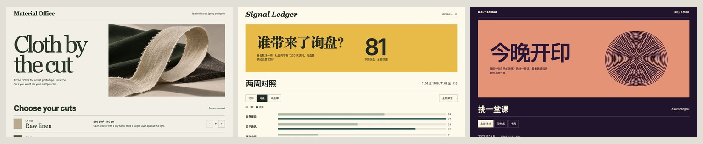
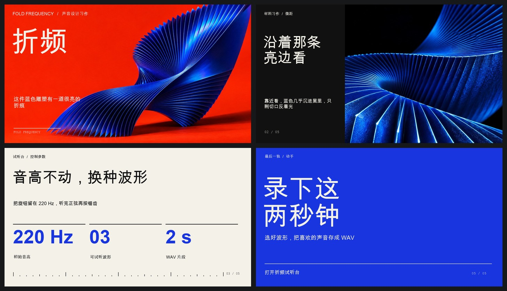

# Joey Design

[](https://joeymilano.github.io/joey-design/)

一个开源设计工具，做 PPT、小红书图文和能在手机上操作的网页，案例里的简报、图片和源文件都放在仓库里

[逛展厅](https://joeymilano.github.io/joey-design/) · [安装 Skill](#installation)

## 选一个手头的活

[](https://joeymilano.github.io/joey-design/#work)

| 场景 | 打开试试 | 拿走什么 |
| --- | --- | --- |
| 给海外买手寄布样 | 在 [Material Office](https://joeymilano.github.io/joey-design/material-office.html) 挑亚麻、斜纹布或帆布，填上每种要几片 | 写好货号、规格和数量的英文询样单 |
| 展会后一周复盘线索 | 在 [Signal Ledger](https://joeymilano.github.io/joey-design/signal-ledger.html) 看买手从哪儿来，用同一张表对比访问和询盘 | 带两期原始计数的 CSV |
| 给印刷夜校排课 | 在 [Night School](https://joeymilano.github.io/joey-design/night-school.html) 挑想上的课，两堂撞时会当场提醒 | 能导入个人日历的 ICS 课表 |

想换成自己的项目，从[三份可编辑简报](skills/joey-design/assets/scenarios)挑一份，课程时间、货号和渠道数字都在里面

## 折频

[](https://joeymilano.github.io/joey-design/fold-proofs.zip)

同一件蓝色雕塑，远看像张开的一把折扇，凑近只剩一条亮边
场域、图录、微距三种封面各排了横竖版和中英文，[下载 12 张校样](https://joeymilano.github.io/joey-design/fold-proofs.zip)，打开 `index.html` 并排挑

[](https://joeymilano.github.io/joey-design/fold-deck-zh.html)

投影上先放整件雕塑，再给切口一个特写，讲到声音时把旋钮停在 220 Hz，点一下锯齿听听变化
[在线翻 PPT](https://joeymilano.github.io/joey-design/fold-deck-zh.html) · [下载中文版](https://joeymilano.github.io/joey-design/fold-deck-zh.pptx) · [英文版](https://joeymilano.github.io/joey-design/fold-deck-en.pptx)

[](https://joeymilano.github.io/joey-design/fold-social.html)

手机上把这个练习拆成五张，最后一张留给想自己试的人
[翻小红书图文](https://joeymilano.github.io/joey-design/fold-social.html) · [拿走图片和正文](https://joeymilano.github.io/joey-design/fold-images.zip)

[](https://joeymilano.github.io/joey-design/fold-app.html)

[打开试听台](https://joeymilano.github.io/joey-design/fold-app.html)，选一种波形，把喜欢的两秒钟存成 WAV

## 其他作品

| 题材 | 成品 |
| --- | --- |
| 光隙 · 建筑摄影 | [中文 PPT](https://joeymilano.github.io/joey-design/lightwalk-deck-zh.html) · [庭院与蓝楼梯的拍摄笔记](https://joeymilano.github.io/joey-design/lightwalk-social.html) · [收藏机位](https://joeymilano.github.io/joey-design/lightwalk-app.html) |
| 反面唱片室 | [落针前翻一张封套](https://joeymilano.github.io/joey-design/side-b-social.html) · [选试听场次](https://joeymilano.github.io/joey-design/side-b-app.html) |
| 工业产品、文化活动、数据研究 | [折叠阅读灯](https://joeymilano.github.io/joey-design/afterhours-deck-zh.html) · [纸上电台](https://joeymilano.github.io/joey-design/paper-radio-deck-zh.html) · [潮位索引](https://joeymilano.github.io/joey-design/tide-index-deck-zh.html) |

## Installation

```sh
npx skills add joeymilano/joey-design --skill joey-design
```

在安装器中选择你的 Agent，也可以将整个 [skills/joey-design](skills/joey-design) 目录复制到支持 Skills 的客户端

也可以直接跟 Codex 或 Claude Code 说

> 用 joey-design 帮我做书店周六的摄影散步，用我上传的照片，给讲座排 4 页中文 PPT，再挑 5 张做小红书，手机上能存下次想去的机位就好

## 本地生成

需要 Python 3.9+，从仓库根目录运行，图片和文案都在本地处理

```sh
git clone https://github.com/joeymilano/joey-design.git
cd joey-design
python3 -m venv .venv
. .venv/bin/activate
python -m pip install -r skills/joey-design/requirements.txt

# 检查中文句号，输出需要改写的字段位置
python skills/joey-design/scripts/joey.py copycheck skills/joey-design/assets/studies/lightwalk.json

# 用自己的货号、渠道数据或课程时间生成工作页
python skills/joey-design/scripts/joey.py scenario skills/joey-design/assets/scenarios/material-office.json --out build/samples

# 同题三种封面，输出并排校样页与 12 张中英文横竖图
python skills/joey-design/scripts/joey.py directions skills/joey-design/assets/studies/fold-deck.json --out build/directions

# 核对简报，生成双语演示与项目页
python skills/joey-design/scripts/joey.py check skills/joey-design/assets/studies/lightwalk-deck.json
python skills/joey-design/scripts/joey.py build skills/joey-design/assets/studies/lightwalk-deck.json --out build/ppt

# 生成整篇图文、逐张 JPG、正文与 ZIP
python skills/joey-design/scripts/joey.py social skills/joey-design/assets/studies/lightwalk.json --out build/social

# 生成可在手机浏览器打开的界面
python skills/joey-design/scripts/joey.py app skills/joey-design/assets/studies/side-b.json --out build/app
```

Windows 通过 `.venv\Scripts\activate` 激活环境，Linux 建议安装 DejaVu 与 Noto CJK 字体

替换素材时，先复制整份 [摄影与唱片室示例](skills/joey-design/assets/studies)，保留 JSON 引用图片的相对路径在 [工业产品示例](examples/afterhours/brief.json) 中，把 `facts.light.value` 从 `2700 K` 改成 `3000 K` 后重建，规格页、结尾、备注和双语销售页会一起更新

[媒介选择与验收](skills/joey-design/references/formats.md) · [演示简报格式](skills/joey-design/references/brief.md) · [图文与 App 简报格式](skills/joey-design/references/studio-brief.md) · [美术指导](skills/joey-design/references/art-direction.md)

## Design credits

Designed by **Joey Zhao**. All projects are fictional studies. The textile study, metallic sculpture, lighting, architecture and record-store images were generated for these examples. Paper Radio and Tide Index use original procedural artwork.

项目参考了 [Guizang PPT Skill](https://github.com/op7418/guizang-ppt-skill) 对浏览器演示的探索，以及 [Huashu Design](https://github.com/alchaincyf/huashu-design) 对跨媒介设计的组织方式，Joey Design 的说明、渲染器、版式与案例独立编写

[MIT License](LICENSE) · [Joey Zhao](https://www.joeyzhao.cc/)
