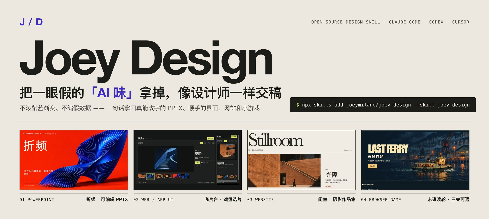
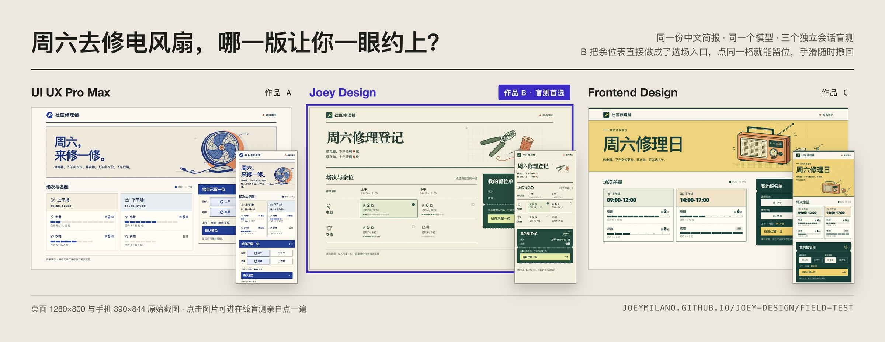
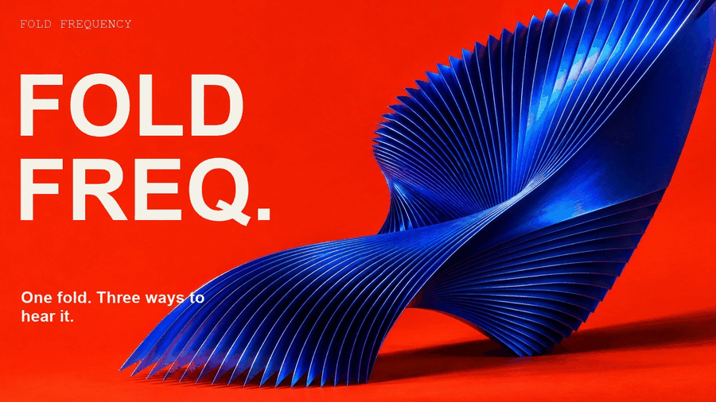
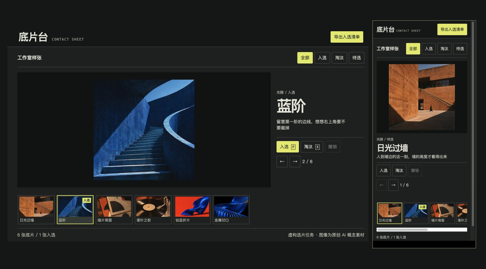
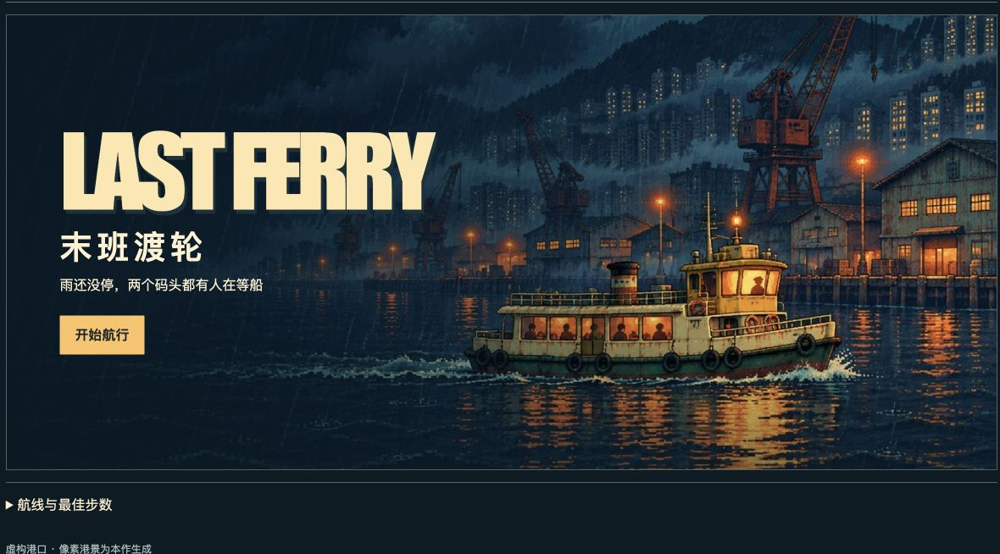
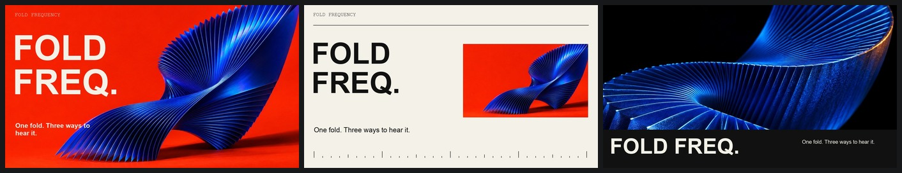
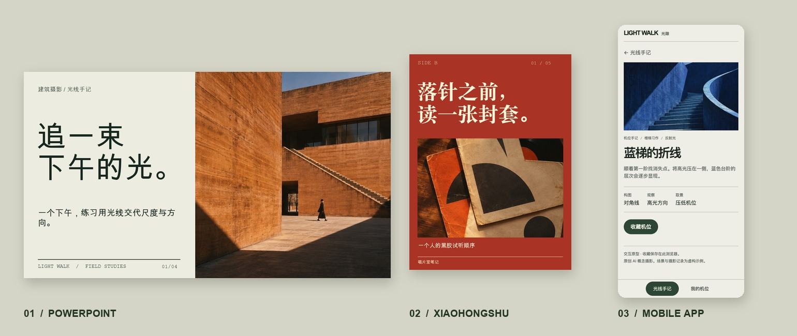
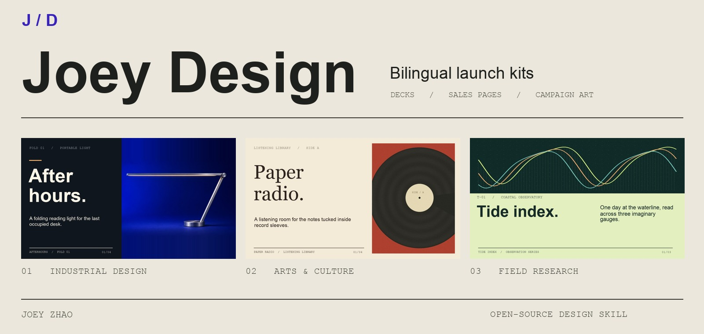

<div align="center">

<sub><b>中文</b> · <a href="README.en.md">English</a> · <a href="https://joeymilano.github.io/joey-design/">在线作品集</a> · <a href="https://joeymilano.github.io/joey-design/field-test/">20 秒同题盲测</a></sub>

<br><br>

<a href="https://joeymilano.github.io/joey-design/"></a>

<br>

[](LICENSE)
[](https://skills.sh)
[](#installation)
[](#installation)
[](#installation)
[](https://github.com/joeymilano/joey-design/actions/workflows/design-review.yml)
[](https://github.com/joeymilano/joey-design/stargazers)

**一个产品设计师写给 AI 的「去 AI 味」交稿指南**<br>
装进 Claude Code、Codex 或 Cursor，拿回真能双击改字的 `.pptx`、顺手好用的界面、作品集网站和能通关的小游戏

```sh
npx skills add joeymilano/joey-design --skill joey-design
```

[先做 20 秒盲测](#先别急着装花-20-秒测测你的眼缘) · [看四种真成品](#装上之后平时能拿它交哪四种活) · [怎么去掉 AI 味](#为什么很多-ai-页面一眼假我给它立了这几条规矩) · [先比稿再延展](#像设计工作室一样先出三版比稿再铺满全套) · [30 秒安装](#installation) · [常见疑问](#你可能想问的几件事)

</div>

---

你肯定见过那种点开第一秒就能认出来的「AI 页面」：

紫蓝渐变铺底，毛玻璃卡片套卡片，每个小标题头上顶一枚圆角小图标；文案张嘴就是「全方位赋能」「一站式体验」，顺手还替你编出「效率提升 300%」和三位根本不存在的客户好评。更让人头疼的是让它做汇报 PPT——甩给你一个改不了字的网页，开会前五分钟还得自己打开 PowerPoint 一页页重排

我平时做产品设计。每次替 AI 返工重做的时候我都在想：它其实不是不会写代码，只是没人教过它**真正交到人手里的东西该长什么样**

所以我把自己平时做图、改文案、在电脑和手机上点通流程的交稿习惯，整理成了这套开源的 **Joey Design**

---

## 先别急着装，花 20 秒测测你的眼缘

光说「没 AI 味」太虚了。我直接拿同一道题拉出来做了一次同台盲测：

题目很简单——**给社区修理铺做一页周六报名表**，让街坊看清上午和下午还剩几个位置，给自己留一位，手滑点错了能撤回。同一个模型、同一份中文需求，分别交给 GitHub 上 **15 万星的 `UI UX Pro Max`**、**Anthropic 官方的 `Frontend Design`** 和 **`Joey Design`** 各自独立跑完：

[](https://joeymilano.github.io/joey-design/field-test/)

**[点这里打开三版盲测页，亲手点两下试试 ↗](https://joeymilano.github.io/joey-design/field-test/)**

页面默认把各版对应的工具名藏起来了。你就当自己周六真要去修台电风扇，试试哪一版不用来回找按钮、在余位表里点一下就能留上名额。试完点底部的「看作者与试做条件」揭晓答案——匿名 AI 评审选的是 **B（Joey Design）**，同时我们也老老实实记下了 A 的优点（首屏摘要把满额时段写得最直接）和 C 首轮翻车在哪

汇报幻灯片我也比了一场：**印厂交货要等两周，手头两本摄影集只能先补印一本，周一发行会上怎么四页让人拍板？**

[](https://joeymilano.github.io/joey-design/field-test/?task=deck)

**[在线左右翻页对比：歸藏 PPT vs Joey Design ↗](https://joeymilano.github.io/joey-design/field-test/?task=deck)**

想象你坐在会议室最后一排翻到第 3 页：D 版的黑底大字很醒目，但得自己在脑子里列算式算缺口；**E 版（Joey Design）** 把「手头现货」和「两周需求」画在同一把刻度尺上，不用心算就能看懂《墙与人》马上断货。两道题的完整简报、入口文件哈希和原始 HTML 都公开在页面里

---

## 装上之后，平时能拿它交哪四种活

每个案例都是直接跑出来的真东西，断网也能离线打开。先点进去玩两下，喜欢哪个直接把下面的话发给你的 Agent 就能换成你自己的内容：

| | |
| :-- | :-- |
| [](https://joeymilano.github.io/joey-design/fold-deck-zh.html) | [](https://joeymilano.github.io/joey-design/contact-sheet.html) |
| **01 · 真能双击改字的 PPT · 《折频》**<br>不是「看着像幻灯片的网页」，是发给同事和老板直接用 PowerPoint 或 Keynote 就能改字、换原图、看讲者备注的 `.pptx`<br>**[在线翻看 5 页成片 ↗](https://joeymilano.github.io/joey-design/fold-deck-zh.html)** · **[下载中文 PPTX 源文件 ↗](https://joeymilano.github.io/joey-design/fold-deck-zh.pptx)**<br><sub>直接跟 Agent 说：「把这份产品介绍改成 8 页中文发布会 PPT，照片用原图，价格页留一张比较表，给我可编辑的 PPTX」</sub> | **02 · 上手就能干活的界面 · 《底片台》**<br>像摄影师在灯箱前挑底片：把画面留给正在看的照片，按 `P` 留片、`X` 淘汰，手快按错了随时撤回，挑完直接导出清单<br>**[打开按两下键盘试试 ↗](https://joeymilano.github.io/joey-design/contact-sheet.html)**<br><sub>直接跟 Agent 说：「做一个手机也能用的素材审核台，把预览图放大，键盘能通过或退回，点错了能撤销」</sub> |
| [](https://joeymilano.github.io/joey-design/stillroom.html) | [](https://joeymilano.github.io/joey-design/last-ferry.html) |
| **03 · 不说废话的作品集与官网 · 《间室》**<br>砍掉「欢迎来到我的网站」那种占满一屏的空话。进门先看作品，每组一幅全景配一幅近景，每个项目都有独立链接能单发给客户<br>**[进去逛一圈 ↗](https://joeymilano.github.io/joey-design/stillroom.html)**<br><sub>直接跟 Agent 说：「用我这三组作品搭一个摄影师网站，首页先放照片，每组作品都有能单独发给客户的链接」</sub> | **04 · 真能通关的小游戏 · 《末班渡轮》**<br>雨还没停，两个码头都有人在等末班船。方向键和触屏都能开，船靠岸灯就灭——生成时脚本先自己验算过一遍，保证每关步数刚好够通关<br>**[上去开三局船试试 ↗](https://joeymilano.github.io/joey-design/last-ferry.html)**<br><sub>直接跟 Agent 说：「做一款能用方向键和触屏玩的短游戏，给我开场、三关、结算和重来按钮」</sub> |

**还有一个做汇报的人会很喜欢的细节：** 打开 [《反面唱片室排场》](https://joeymilano.github.io/joey-design/listening-room.html)，再把它的 [三页中文 PPTX](https://joeymilano.github.io/joey-design/listening-room.pptx) 下载回电脑——在 PowerPoint 第二页右键柱状图点「编辑数据」，里面嵌的是真 Excel 表，改一下人数柱子当场跟着动，网页和中英文演示读的都是[同一份数据](skills/joey-design/assets/studies/listening-room.json)

---

## 为什么很多 AI 页面一眼假？我给它立了这几条规矩

平时审稿踩过的坑，我都写成了硬性约束和自动检查脚本：

- **先问「看的人要拿它做什么决定」，再动手画** — 是要在会上拍板补印哪本书，还是在手机上挑时间报名？想清楚这一步，版面重心自然就出来了，根本用不着拿花哨背景凑数
- **从手头的东西里找长相，别去套模板** — 挑胶片的工具就长成底片条，开渡轮的游戏就把剩余步数写成航程，不往所有题目上泼紫蓝渐变
- **说人话，尤其把中文写干净** — 换到别家产品上也成立的空话一律删掉；中文大标题和按钮末尾不挂句号；按钮不写冷冰冰的「提交」「确定」，而是写清动作和结果，比如「导出入选清单」「下载询样单」
- **没发生过的事，一个字都不许编** — 不编客户好评、不编获奖头衔、不编「增长 300%」；如果是演示数据，老老实实在画面角落标明来历和估算口径
- **自己先在电脑和手机上点通一遍，再交出来** — 先拿超长名字、名额已满、点错撤销去撞一遍，再用 `review` 在桌面（`1280×800`）和手机（`390×844`）各跑一遍真实交互并留截图，不拿一戳就破的静态页面糊弄人

| AI 默认爱犯的老毛病 | Joey Design 怎么改 |
| --- | --- |
| 紫蓝渐变、发光毛玻璃、三栏等宽圆角图标卡片 | 从项目自己的素材里取主形状、比例和留白，每一屏只干一件事 |
| 「开启全新沉浸式体验」「全方位赋能业务」 | 放到别家产品也成立的句子直接删掉，写清点完能拿到什么 |
| 随手编造「效率提升 300%」「10 万用户好评」 | 给真数据才写数据；估算写明口径，样例在画面里标清来历 |
| 中文标题句句带句号，按钮写「立即提交」 | 展示标题与按钮去句号，`copycheck` 自动抓标点，按钮直写动词加对象 |
| 首屏截图挺唬人，一点按钮或换手机屏幕就塌 | 键盘快捷键、触屏热区、空状态和撤销全部做实，双端走查通过再交付 |
| 生成网页假装是 PPT，发给同事根本改不了字 | 交付原生 `.pptx`，文字、裁切原图、讲者备注与图表数据都能直接改 |

想看底层的具体写法，可以翻看 [设计与验收方法](skills/joey-design/references/product-work.md) · [中文文案示例](skills/joey-design/references/chinese-copy.md) · [浏览器走查规范](skills/joey-design/references/design-review.md)

---

## 像设计工作室一样：先出三版比稿，再铺满全套

做视觉要求高的项目时，好设计师不会上来就死磕一版。`directions` 会先拿同一份文案和同一张原图排三版不同构图的封面校样，放在同一尺寸下比字号、主体比例、裁切和视线顺序；挑中最对味的一版后，再把同一个视觉母题一路延展到幻灯片、小红书 3:4 竖版图文和手机界面里

<p align="center">
  <a href="https://joeymilano.github.io/joey-design/fold-deck-zh.html"></a>
</p>

<p align="center">
  <a href="https://joeymilano.github.io/joey-design/fold-deck-zh.html"></a>
</p>

<p align="center">
  <a href="https://joeymilano.github.io/joey-design/archive.html#social"></a>
</p>

除了上面那四套，仓库里还备好了三套完整的中英文双语发布套件，以及面料买手选样、展会询盘周报、夜校排课三张真实业务场景页，点图片都能直接进去试：

<p align="center">
  <a href="https://joeymilano.github.io/joey-design/archive.html"></a>
</p>

<p align="center">
  <a href="https://joeymilano.github.io/joey-design/archive.html"></a>
</p>

[逛逛全部历史案例与小红书样张 ↗](https://joeymilano.github.io/joey-design/archive.html) · [下载三套封面比稿校样包 (.zip)](https://joeymilano.github.io/joey-design/fold-proofs.zip)

---

<a id="installation"></a>

## 30 秒装好，拿手头现成的活试试

```sh
npx skills add joeymilano/joey-design --skill joey-design
```

跑完命令，在列表里勾上你平时顺手的 **Claude Code**、**Codex** 或 **Cursor** 就行。如果你不想跑命令行，直接把仓库里的 [`skills/joey-design`](skills/joey-design) 文件夹复制进客户端的 skills 目录也完全一样

装好之后不用背任何特殊指令，像平时在微信里给设计师交代活儿那样直接说需求、扔素材就行：

```text
把这份介绍改成 8 页中文产品发布 PPT，照片用原图，价格页留一张比较表，给我可编辑的 PPTX
```

```text
帮我改一下现在这个后台审核页，把图片预览放大，加上键盘通过和退回快捷键，点错了能撤销
```

```text
给下周的新品做一组 5 张小红书 3:4 竖图，用我文件夹里的实拍图，别用感叹号和营销套话
```

### 幕后是怎么跑的


<details>
<summary><b>想在本地直接用 Python 跑脚本？点开看全部命令（Python 3.9+）</b></summary>

<br>

除了让 Agent 自动调用，你也可以在本地直接跑 `skills/joey-design/scripts/joey.py`：

| 命令 | 交出什么 |
| --- | --- |
| `build` | 中英文双语可编辑 `.pptx`、网页演示与配套落地页 |
| `ui` | 带键盘操作、触屏适配、本地保存与撤销的离线 Web / App 界面 |
| `site` | 响应式作品集、品牌官网或落地页，每组作品有独立分享链接 |
| `game` | 浏览器小游戏原型，生成阶段自动验算每关在步数内有解 |
| `directions` | 同一主题的三版封面构图校样 |
| `social` | 小红书 3:4 多图轮播卡片与导出包 |
| `app` | 手机端交互研究稿 |
| `scenario` | 采购选样、渠道周报、课程排期等业务场景单页 |
| `check` / `copycheck` | 检查简报结构与图片引用，抓出中文标点和文案硬伤 |
| `review` | 开浏览器在桌面与手机宽度自动走完用户旅程，保存截图与问题记录 |

从仓库根目录跑通四个内置示例：

```sh
python3 -m venv .venv
. .venv/bin/activate
python -m pip install -r skills/joey-design/requirements.txt

SKILL=skills/joey-design
python "$SKILL/scripts/joey.py" build "$SKILL/assets/studies/fold-deck.json" --out build/ppt
python "$SKILL/scripts/joey.py" ui "$SKILL/assets/studies/contact-sheet.json" --out build/ui
python "$SKILL/scripts/joey.py" site "$SKILL/assets/studies/stillroom.json" --out build/site
python "$SKILL/scripts/joey.py" game "$SKILL/assets/studies/last-ferry.json" --out build/game
```

Windows 用 `.venv\Scripts\activate` 激活环境；Linux 渲染中文图片建议装上 `fonts-noto-cjk`。换成自己的内容时，先复制 [`skills/joey-design/assets/studies`](skills/joey-design/assets/studies) 里的示例 JSON 和图片再改

</details>

---

## 你可能想问的几件事

<details>
<summary><b>我已经装了 UI UX Pro Max / Impeccable / Frontend Design，还需要装这个吗？</b></summary>

<br>

完全不冲突，它们干的不是同一件事：
- **UI UX Pro Max** 像一本厚厚的风格色卡字典，适合查配色和字体组合
- **Impeccable** 擅长用细分指令给写好的组件做体检和微调
- **Joey Design** 管的是「从拿到需求到交出真文件」这一整套活——先想清楚用户决定，能同时交出**原生可编辑 `.pptx`、能操作的界面、网站和能通关的游戏**，而且专门治中文里的「赋能腔」和满屏句号。你可以把它们装在一起配合用

</details>

<details>
<summary><b>放到我写了一半的 React / Next.js / Vue 项目里也能用吗？</b></summary>

<br>

能用。对着已有项目干活时，它会保留你原来的技术栈、路由、真实文案和存储逻辑，只按任务主次和桌面/手机双端标准重做界面，不会把你的工程硬改成静态单页

</details>

<details>
<summary><b>只能做中文吗？可以免费商用吗？</b></summary>

<br>

中英文都能做，`build` 默认一次吐出中英双语两套可编辑 PPTX 和网页，共用同一份底层数字，两边不会对不上账。代码和规则采用 [MIT 协议](LICENSE) 完全开源，个人和商业项目都免费；正式上线商业项目时，记得把演示里的原创概念图换成你有授权的实拍图或产品图

</details>

---

## 觉得顺手的话，留颗 Star 吧

如果你平时也受够了替 AI 删紫蓝渐变、改套话、重排 PPT，希望这个小工具能帮你少加一会儿班

右上角点颗 **Star** 能让更多做产品、写代码的朋友刷到它；如果你在别的项目里碰到了什么让人抓狂的「重灾区 AI 设计套路」，欢迎直接丢到 [Issues](https://github.com/joeymilano/joey-design/issues) 里，我们一起写进规则库把它治掉

<a href="https://star-history.com/#joeymilano/joey-design&Date">
  <picture>
    <source media="(prefers-color-scheme: dark)" srcset="https://api.star-history.com/svg?repos=joeymilano/joey-design&type=Date&theme=dark" />
    
  </picture>
</a>

## 灵感与致谢

四条交付线分别向四个我非常喜欢的开源项目借了骨架：开发者演示 [Slidev](https://github.com/slidevjs/slidev) · 可定制组件 [shadcn/ui](https://github.com/shadcn-ui/ui) · 内容网站 [Astro](https://github.com/withastro/astro) · 浏览器游戏 [Phaser](https://github.com/phaserjs/phaser)

---

<div align="center">

Designed by **[Joey Zhao](https://www.joeyzhao.cc/)** · [MIT License](LICENSE)

</div>
