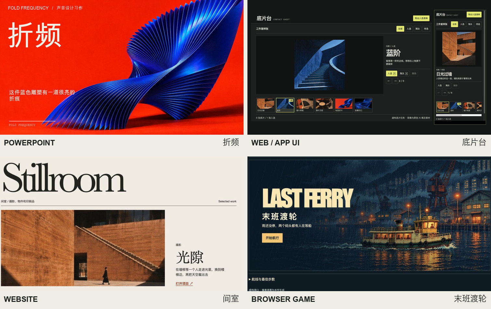

# Joey Design

**低 AI 味的开源设计 Skill，做 PPT、高审美 Web / App UIUX、网站和游戏**

[](https://joeymilano.github.io/joey-design/)

[看在线案例](https://joeymilano.github.io/joey-design/) · [安装 Skill](#installation) · [Read the skill in English](skills/joey-design/SKILL.md)

| 我想做 | 先打开一个成品 | 用自己的内容重做 |
| --- | --- | --- |
| **PPT / PowerPoint** | [翻看《折频》](https://joeymilano.github.io/joey-design/fold-deck-zh.html) · [下载可编辑中文版](https://joeymilano.github.io/joey-design/fold-deck-zh.pptx) | 给一份产品介绍或路演提纲，文字、图片、讲者备注都能在 PowerPoint 里改 |
| **Web / App UIUX** | [打开《底片台》](https://joeymilano.github.io/joey-design/contact-sheet.html)，按 P 留片、X 淘汰，选完导出清单 | 替换成自己的照片，或让 Agent 按真实产品流程设计桌面和手机界面 |
| **网站** | [逛《间室》作品集](https://joeymilano.github.io/joey-design/stillroom.html)，按类别找作品，打开详情看近景 | 换上项目和图片，做好品牌官网、作品集或带明确行动入口的产品落地页 |
| **游戏** | [玩《末班渡轮》](https://joeymilano.github.io/joey-design/last-ferry.html)，用有限的航程接齐乘客，跑完三关 | 改角色、地图与步数，生成自己的浏览器游戏 |

## 同一道题，打开试试

[三版修理铺报名页](https://joeymilano.github.io/joey-design/field-test/)共用一份简报。试着比较上午和下午的名额、选一场、留一位，再刷新或撤销。先体验作品，再展开看各自用了哪个 Skill

[两本摄影册，先补印哪本？](https://joeymilano.github.io/joey-design/field-test/?task=deck) 歸藏 PPT 和 Joey Design 拿到相同的两张照片、四周销量和库存，各做四页发行会演示。翻到第三页，看哪版让你更快决定先印哪本

[反面唱片室排场](https://joeymilano.github.io/joey-design/listening-room.html)有八把空椅子，应该搬到哪一场？[下载三页中文 PPTX](https://joeymilano.github.io/joey-design/listening-room.pptx)，在第二页点图表的「编辑数据」，可以改人数。网页表格、图表和中英文演示共享[同一份数据](skills/joey-design/assets/studies/listening-room.json)

## Installation

```sh
npx skills add joeymilano/joey-design --skill joey-design
```

在安装器里选 Codex、Claude Code 或你使用的客户端，也可以直接复制 [skills/joey-design](skills/joey-design)

## 怎么开工

- **演示**　“把这份介绍改成 8 页中文产品发布 PPT，照片用原图，价格页留一张比较表，给我可编辑的 PPTX”
- **界面**　“做一个手机也能用的素材审核台，把预览图放大，键盘能通过或退回，点错了能撤销”
- **网站**　“用我这三组作品搭一个摄影师网站，首页先放照片，每组作品都有能单独发给客户的链接”
- **游戏**　“做一款能用方向键和触屏玩的短游戏，给我开场、三关、结算和重来按钮”

## 低 AI 味怎么落到画面上

《底片台》把位置留给正在看的照片，选片按钮贴在旁边，点完可以撤销
《间室》让每组作品用一张全景和一张近景说话
《末班渡轮》把剩余步数写成航程，船靠站后灯就灭，玩家看画面就知道刚才发生了什么

中文标题和按钮不用句号，不编客户评价、奖项和增长数字
[设计与验收方法](skills/joey-design/references/product-work.md) · [中文文案示例](skills/joey-design/references/chinese-copy.md)

## 交付前走一遍

`review` 会在桌面和手机宽度从头操作一次，保存截图、已完成的步骤和异常。可以给自己的离线 HTML 写操作步骤，也可以直接复跑这个仓库的[四个示例](skills/joey-design/assets/journeys)。[用法与验收范围](skills/joey-design/references/design-review.md)

## 本地生成

需要 Python 3.9+，从仓库根目录运行

```sh
python3 -m venv .venv
. .venv/bin/activate
python -m pip install -r skills/joey-design/requirements.txt

SKILL=skills/joey-design
python "$SKILL/scripts/joey.py" build "$SKILL/assets/studies/fold-deck.json" --out build/ppt
python "$SKILL/scripts/joey.py" ui "$SKILL/assets/studies/contact-sheet.json" --out build/ui
python "$SKILL/scripts/joey.py" site "$SKILL/assets/studies/stillroom.json" --out build/site
python "$SKILL/scripts/joey.py" game "$SKILL/assets/studies/last-ferry.json" --out build/game
```

Windows 用 `.venv\Scripts\activate` 激活环境，Linux 渲染中文图片时建议安装 Noto CJK 字体
复制[示例简报和图片](skills/joey-design/assets/studies)后再修改，保留图片的相对路径
网页案例都能离线打开，游戏生成器会先检查每关能否在步数内通关

[全部演示和旧案例](https://joeymilano.github.io/joey-design/archive.html) · [小红书图文](https://joeymilano.github.io/joey-design/archive.html#social) · [三套封面校样](https://joeymilano.github.io/joey-design/fold-proofs.zip) · [查看原有命令](skills/joey-design/scripts/joey.py)

## GitHub 参考

四个入口分别参考了开发者演示、可定制界面组件、内容网站和浏览器游戏的实际项目形态
[Slidev](https://github.com/slidevjs/slidev) · [shadcn/ui](https://github.com/shadcn-ui/ui) · [Astro](https://github.com/withastro/astro) · [Phaser](https://github.com/phaserjs/phaser)

## Design credits

Designed by **Joey Zhao**. All projects are fictional studies. The harbour illustration, textile study, metallic sculpture, lighting, architecture and record-store images were generated for these examples. Paper Radio and Tide Index use original procedural artwork.

项目参考了 [Guizang PPT Skill](https://github.com/op7418/guizang-ppt-skill) 对浏览器演示的探索，以及 [Huashu Design](https://github.com/alchaincyf/huashu-design) 对跨媒介设计的组织方式，Joey Design 的说明、渲染器、版式与案例独立编写

[MIT License](LICENSE) · [Joey Zhao](https://www.joeyzhao.cc/)
