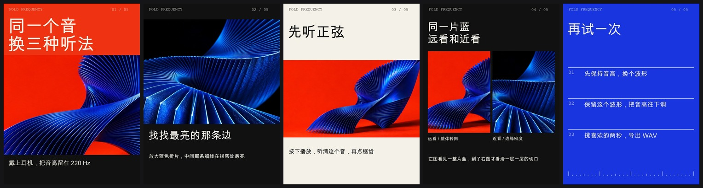
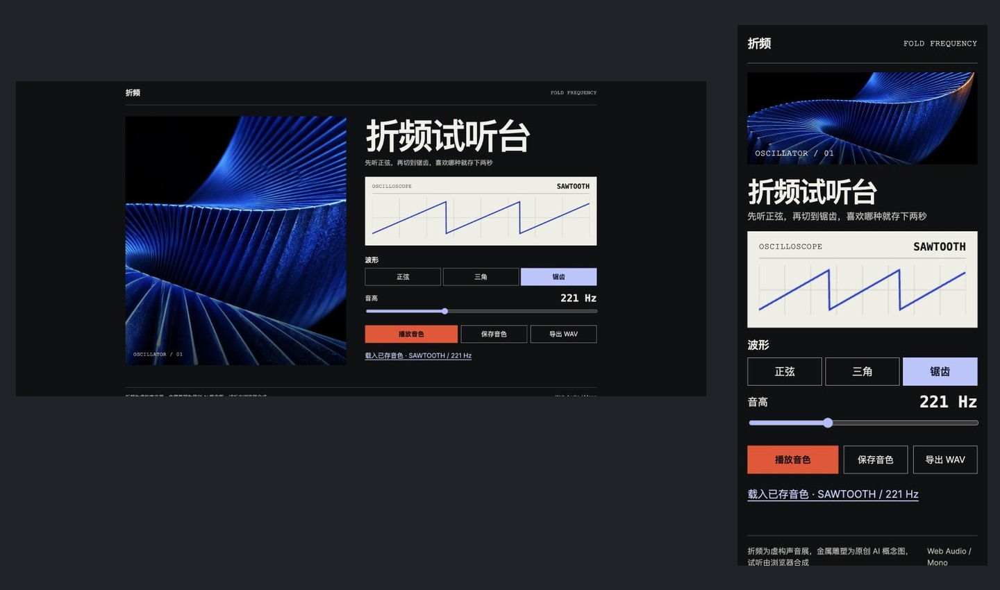

# Joey Design.

[](https://joeymilano.github.io/joey-design/)

**从一件雕塑，到两秒声音。** 《折频》是 Joey Design 做的一场声音设计习作。你可以在 PowerPoint 里改展签，在手机上翻五张图版，也可以直接演奏虚拟试听台，把自己的音色存成 WAV。

[进入展厅](https://joeymilano.github.io/joey-design/) · [演奏试听台](https://joeymilano.github.io/joey-design/fold-app.html) · [下载中文 PPTX](https://joeymilano.github.io/joey-design/fold-deck-zh.pptx) · [安装 Skill](#installation)

## 展览手记

**同一个题目，先看三种封面。** 场域版让文字落在雕塑的负空间，图录版缩小作品、留出纸面，微距版把金属边缘推到满版。三种构图都独立排了中英文和横竖画幅。下载后打开 `index.html`，即可并排切换 12 张样张。

[](https://joeymilano.github.io/joey-design/fold-proofs.zip)

**横版演示。** 开场看整个物体，第二页只看折痕，第三页把初始音高、波形数量和导出时长并排。图像与文字可独立编辑。 [在线翻页](https://joeymilano.github.io/joey-design/fold-deck-zh.html) · [英文 PPTX](https://joeymilano.github.io/joey-design/fold-deck-en.pptx)

[](https://joeymilano.github.io/joey-design/fold-deck-zh.html)

**小红书图文。** 五张连续的 3:4 竖图，从看折痕讲到听波形。每张都能下载，整套附中文正文、话题与素材署名。 [翻图](https://joeymilano.github.io/joey-design/fold-social.html) · [下载整套](https://joeymilano.github.io/joey-design/fold-images.zip)

[](https://joeymilano.github.io/joey-design/fold-social.html)

**移动试听台。** 让正弦、三角和锯齿停在同一个音高，耳朵会听见差异。播放、调音、保存、重新载入和导出都在浏览器完成。

[](https://joeymilano.github.io/joey-design/fold-app.html)

## 作品集

| 媒介 | 能拿到什么 | 公开案例 |
| --- | --- | --- |
| PowerPoint | 5 组中英双语演示，10 份可编辑 PPTX。均含演讲者备注、网页演示、项目页、横竖封面。 | [折频 · 声音展](https://joeymilano.github.io/joey-design/fold-deck-zh.html) · [光隙 · 建筑摄影](https://joeymilano.github.io/joey-design/lightwalk-deck-zh.html) · [After hours. · 工业产品](https://joeymilano.github.io/joey-design/afterhours-deck-zh.html) · [Paper radio. · 文化活动](https://joeymilano.github.io/joey-design/paper-radio-deck-zh.html) · [Tide index. · 数据研究](https://joeymilano.github.io/joey-design/tide-index-deck-zh.html) |
| 小红书 | 3 篇各 5 张的 1080 × 1440 图文，含封面、分解页、对照页和清单。整套可下载，附正文与话题标签。 | [把声音折起来](https://joeymilano.github.io/joey-design/fold-social.html) · [追一束下午的光](https://joeymilano.github.io/joey-design/lightwalk-social.html) · [落针之前，读一张封套。](https://joeymilano.github.io/joey-design/side-b-social.html) |
| 移动 App | 3 个可操作的响应式网页原型。试听台可以合成音色并导出 WAV。摄影工具支持筛选、详情与收藏。唱片室支持选场、预约、改期与取消。演示状态保存在当前浏览器。 | [折频 · 听音](https://joeymilano.github.io/joey-design/fold-app.html) · [光隙 · 机位手记](https://joeymilano.github.io/joey-design/lightwalk-app.html) · [反面唱片室 · 试听预约](https://joeymilano.github.io/joey-design/side-b-app.html) |

想看设计如何随媒介改变，可以从《光隙》开始。演示把建筑照片横排，让观众比较人物和台阶怎样引导视线。小红书把两个拍摄动作拆开，让读者边滑边学。手机端把照片做成机位卡，出门前能按光线筛选，再存下想练的那张。

## Installation

```sh
npx skills add joeymilano/joey-design --skill joey-design
```

在安装器中选择你的 Agent，也可以将整个 [skills/joey-design](skills/joey-design) 目录复制到支持 Skills 的客户端。

试着给 Codex 或 Claude Code 这条简报：

> 用 joey-design 为独立书店的摄影散步做三份东西。讲座需要 4 页可编辑中文 PPT，小红书需要 5 张给初学者的构图笔记，手机端让读者按光线筛选机位并收藏。三份都用我上传的照片，给我能直接打开的成品。

## 本地生成

从项目根目录运行。需要 Python 3.9+。图片、文案及渲染均可在本地处理，无需 API 密钥。

```sh
git clone https://github.com/joeymilano/joey-design.git
cd joey-design
python3 -m venv .venv
. .venv/bin/activate
python -m pip install -r skills/joey-design/requirements.txt

# 同题三种封面，输出并排校样页与 12 张中英文横竖图
python skills/joey-design/scripts/joey.py directions skills/joey-design/assets/studies/fold-deck.json --out build/directions

# 核对简报，生成双语演示与项目页
python skills/joey-design/scripts/joey.py check skills/joey-design/assets/studies/lightwalk-deck.json
python skills/joey-design/scripts/joey.py build skills/joey-design/assets/studies/lightwalk-deck.json --out build/ppt

# 生成整篇图文、逐张 JPG、正文与 ZIP
python skills/joey-design/scripts/joey.py social skills/joey-design/assets/studies/lightwalk.json --out build/social

# 生成可在手机浏览器打开的界面
python skills/joey-design/scripts/joey.py app skills/joey-design/assets/studies/side-b.json --out build/app
```

Windows 通过 `.venv\Scripts\activate` 激活环境。Linux 建议安装 DejaVu 与 Noto CJK 字体。

替换素材时，先复制整份 [摄影与唱片室示例](skills/joey-design/assets/studies)，保留 JSON 引用图片的相对路径。在 [工业产品示例](examples/afterhours/brief.json) 中，把 `facts.light.value` 从 `2700 K` 改成 `3000 K` 后重建，规格页、结尾、备注和双语销售页会一起更新。

[媒介选择与验收](skills/joey-design/references/formats.md) · [演示简报格式](skills/joey-design/references/brief.md) · [图文与 App 简报格式](skills/joey-design/references/studio-brief.md) · [美术指导](skills/joey-design/references/art-direction.md)

## Design credits

Designed by **Joey Zhao**. All projects are fictional studies. The metallic sculpture, lighting, architecture and record-store images were generated for these examples. Paper Radio and Tide Index use original procedural artwork.

项目参考了 [Guizang PPT Skill](https://github.com/op7418/guizang-ppt-skill) 对浏览器演示的探索，以及 [Huashu Design](https://github.com/alchaincyf/huashu-design) 对跨媒介设计的组织方式。Joey Design 的说明、渲染器、版式与案例独立编写。

[MIT License](LICENSE) · [Joey Zhao](https://www.joeyzhao.cc/)
